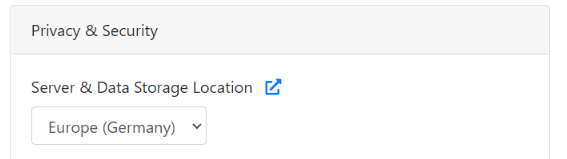
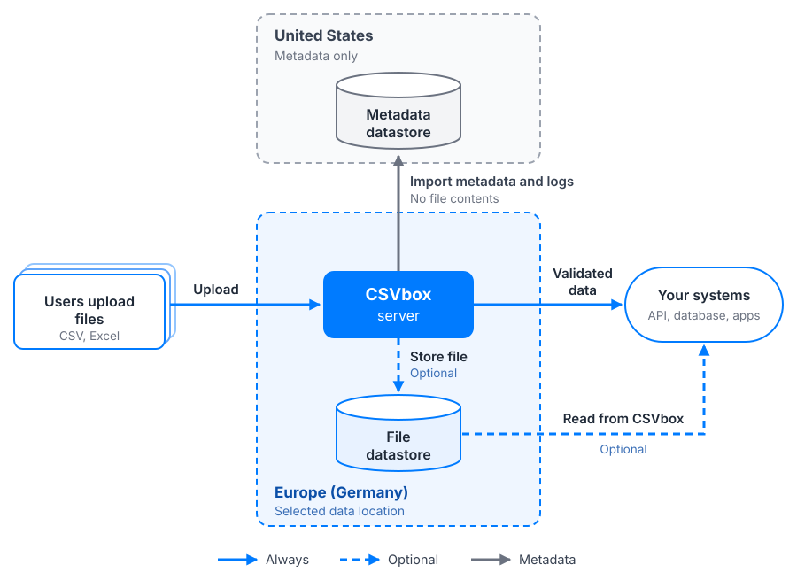
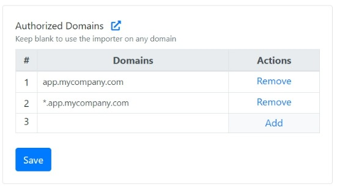
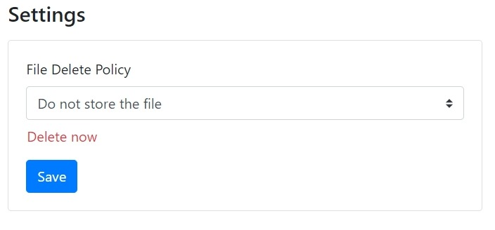

The **Security** tab controls where your users' data is stored, where the importer can run, and how long files are kept. The settings below appear in the same order as in the dashboard.

<a id="server-and-data-location" style={{ scrollMarginTop: "var(--scroll-mt, 7rem)" }} />

<a id="server--data-location" style={{ scrollMarginTop: "var(--scroll-mt, 7rem)" }} />

## Server and data storage location

Select the geographic location of the servers and database for the user data.

Data residency refers to the geographical location where data is stored. The location is usually important for regulatory or policy reasons. You can select the storage location of the data uploaded by your users.

Go to **Edit Sheets** → **Options** → **Privacy & Security** section and select the location from the **Server & Data Storage Location** dropdown.

<Frame>
  
</Frame>

The US is the default location. The other option is Europe (Germany). The data uploaded by users then passes through servers and is stored in the database situated in the selected location only.

<Note>
  You also have the option to not store the data at all. See [File delete policy](#file-delete-policy).
</Note>

The long-lived data about the import and the user files isn't covered by the selected location. It mainly consists of supplementary log data that helps with troubleshooting and analyzing the import processes. This data doesn't include any original data from inside the user files.

The image below shows how the data flows if you select Europe as the data residency location.

<Frame>
  
</Frame>

## Authorized domains

Run the importer on select domains only.

Go to **Edit Sheets** → **Options** → **Authorized Domains** and provide a list of authorized _domains/subdomains_ for embedding the importer. The embedded importer works on the whitelisted domains only.

<Frame>
  
</Frame>

- If you don't whitelist any domain, the importer embed works on all domains. This is the default configuration.
- You can use the `*` wildcard prefix to include any subdomain. A few examples:

| Text | Valid | Invalid |
| --- | --- | --- |
| `exampleco.com` | `exampleco.com` | `www.exampleco.com`, `app.exampleco.com` |
| `www.exampleco.com` | `www.exampleco.com` | `exampleco.com`, `app.exampleco.com` |
| `app.exampleco.com` | `app.exampleco.com` | `exampleco.com`, `www.exampleco.com` |
| `*.exampleco.com` | All `exampleco.com` subdomains |  |

If a domain fails validation, the user sees an **Unauthorized domain** error instead of the importer.

## Import links

Import Links let you accept files from your users without a website or an app. Create an import page in a few clicks and share the link with your users, with no code required. It's an alternative to the import button that you set up by adding the integration code.

You can turn the sheet's import link on or off with the **Import Links** setting. If import links are deactivated, users see a **File imports disabled** message instead of the importer.

To find the import link and add custom user attributes to it, see [Code Snippet](/sheet-settings/code-snippet).

## File delete policy

Manage user data storage in CSVbox.

Enable or disable the storage of user-uploaded data in CSVbox. You can decide based on privacy preferences or specific sheet requirements.

<Frame>
  
</Frame>

- **Do not store the file**: When enabled, user-uploaded data isn't stored in the CSVbox datastore.
- **Delete one month after file upload**: Data is stored on CSVbox storage and auto-deleted one month after upload.

The policy applies to future uploads only. Changing it doesn't delete files that are already stored.

<Note>
  To keep user data off CSVbox servers and data stores entirely, see [Private Mode](/destinations/private-mode).
</Note>

### Change the policy on all sheets

Instead of opening each sheet's settings, you can set the File Delete Policy on every sheet in your workspace in one step.

<Steps>
  <Step title="Open the bulk action">
    Open the **Sheets** list. Click **Bulk actions** (next to **Tags**), then **File delete policy…**.
  </Step>
  <Step title="Review the counts">
    The dialog shows how many sheets the change covers and how many are already on each policy.
  </Step>
  <Step title="Choose a policy">
    Select **Do not store the file** or **Delete one month after file upload**. No policy is preselected, and **Apply** stays disabled until you choose one.
  </Step>
  <Step title="Apply the change">
    Click **Apply**. A message reports how many sheets were changed, how many were skipped, and how many couldn't be updated.
  </Step>
</Steps>

#### Which sheets change

- **Every sheet in the current workspace.** The change ignores any search or tag filter on the Sheets list.
- In your **personal workspace**, only your own sheets change. In a **team workspace**, only that team's sheets change. Other users' and other teams' sheets are never changed.
- Sheets already on the chosen policy are left as they are.
- Deleted sheets are not included.
- If a sheet's settings can't be updated, it's reported as "could not be updated". Change the policy on that sheet from its own settings.

#### Sheets that would lose data

When a sheet has no destination and doesn't send a copy of the data to the client, its uploaded file is the only copy of the imported data. Setting such a sheet to **Do not store the file** means the imported data is saved nowhere.

When you choose **Do not store the file**:

- **These sheets are skipped by default.** The dialog shows a warning with the number of sheets that will be skipped.
- To change them anyway, select **Include them anyway** in the warning. The checkbox is cleared every time you open the dialog.
- Sheets with no destination that do send a copy of the data to the client are changed. Their data then reaches only your page's JavaScript callback, and can't be downloaded from the dashboard.

#### Who can use it

Only users with permission to edit sheets see the **Bulk actions** button. If a user without this permission reaches the action, CSVbox blocks it with "You do not have permission to change sheet settings."
